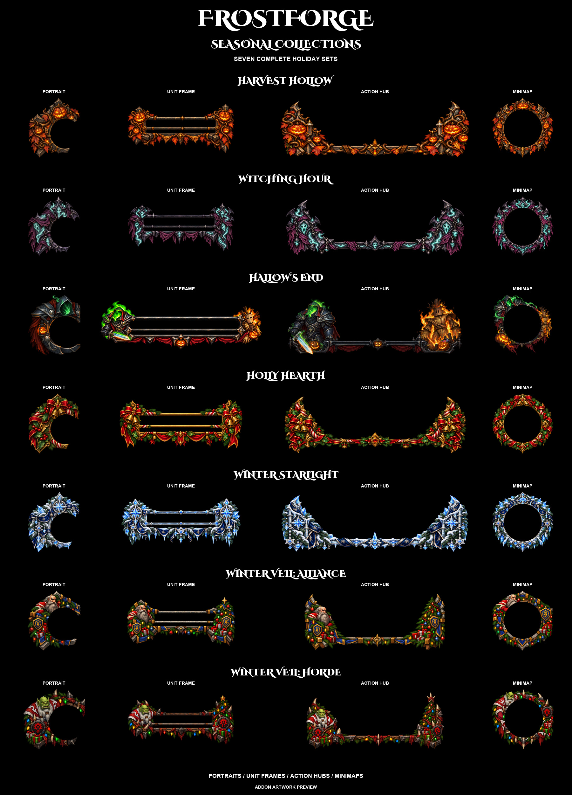
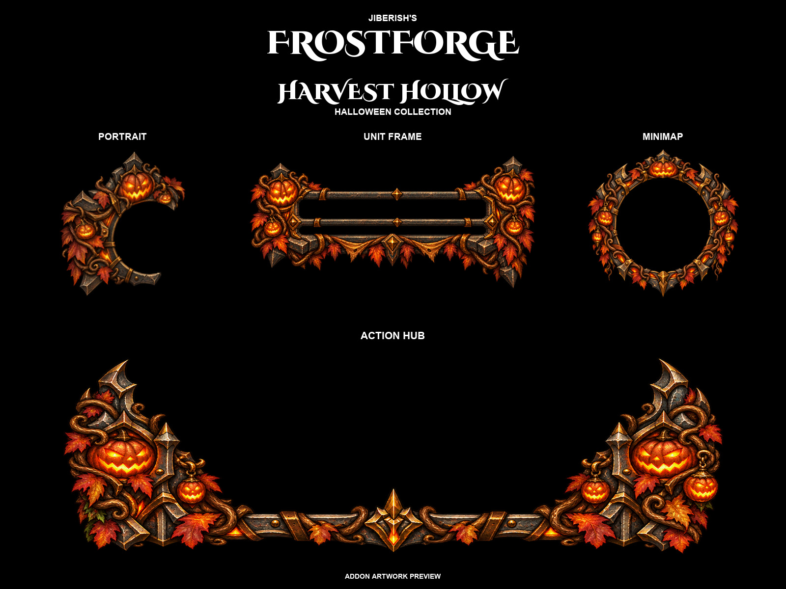
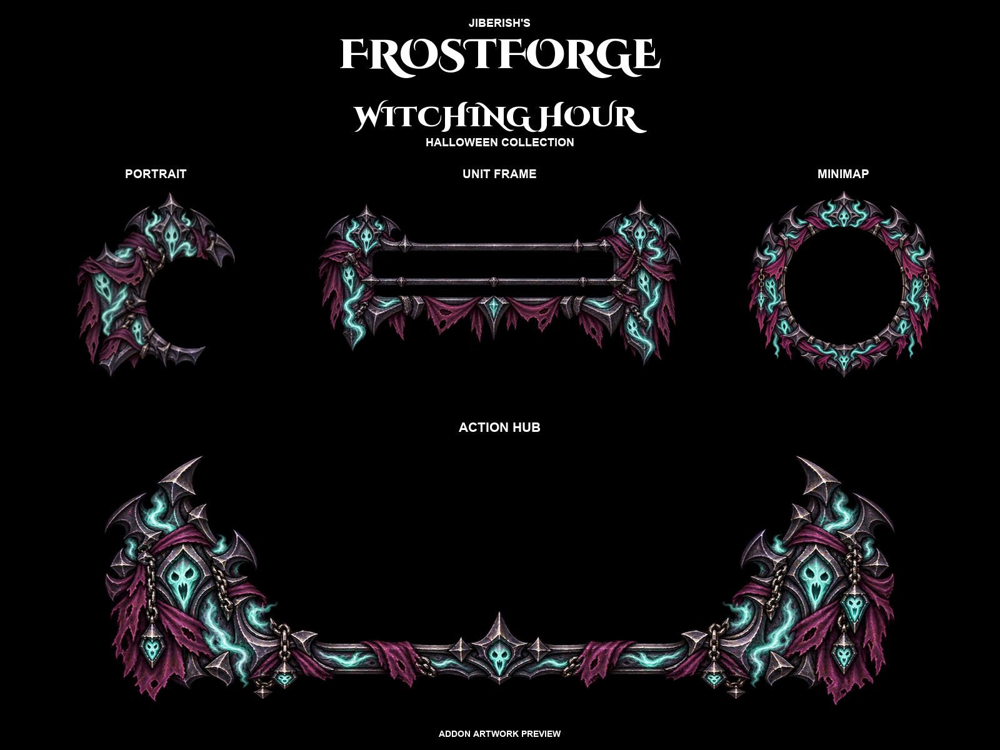
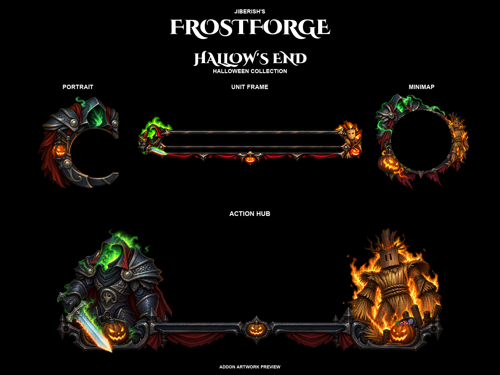
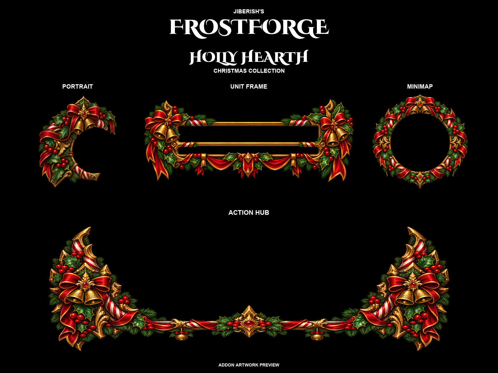
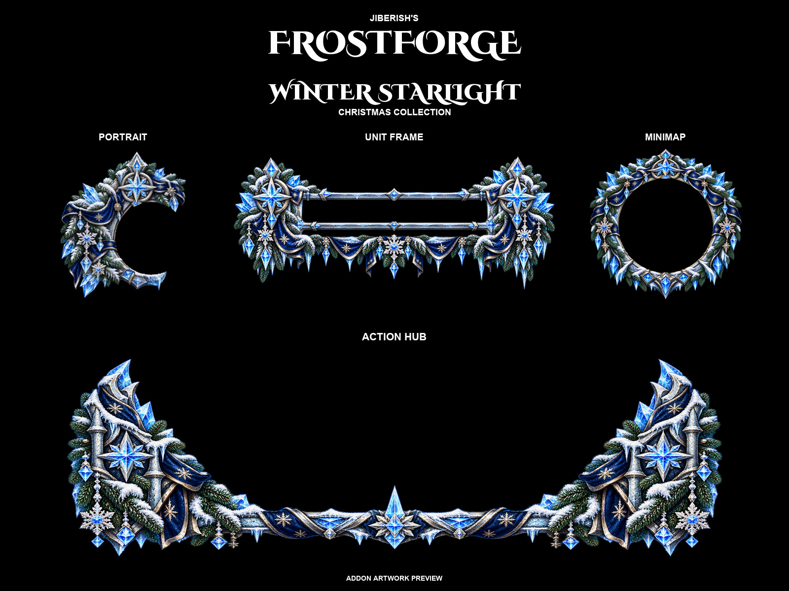
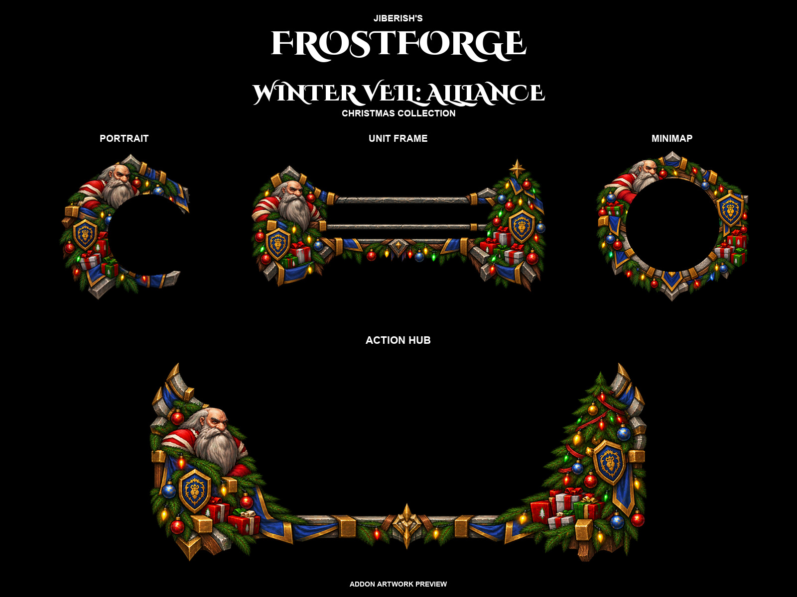
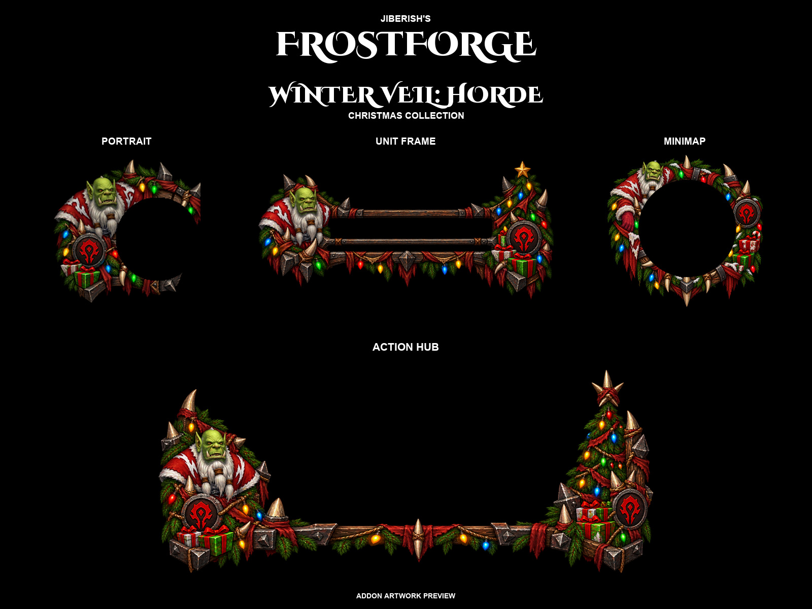

# Frostforge artwork

42 matching class, race and faction themes, plus 10 NPC creature portrait and frame themes and seven complete seasonal options. Browse portrait and full-frame art in **Player / Target / Focus → Artwork**; the other components have their own artwork choices.

*Player-supplied in-game screenshot.*

*Preview made from the shipped textures with illustrative bars.*

Share your setup or ask for fitting help in [The Igloo Discord](https://discord.com/servers/igloo-460933747731070996).

*New creature artwork shown at two sizes; a runtime-art preview, not an in-game screenshot.*

## Seasonal collections

Choose **Seasonal** in the portrait, unit-frame, action hub or minimap browser. Each component can be selected independently. The portrait and unit-frame browsers share the selected unit's theme.

| Collection | Holiday | Artwork |
| --- | --- | --- |
| Harvest Hollow | Halloween | Glowing pumpkins, autumn leaves, bronze and dark iron |
| Witching Hour | Halloween | Haunted violet, ghostly turquoise, bats and tattered cloth |
| Hallow’s End | Halloween | Headless Horseman armor and green fire paired with a distinct burning Wickerman |
| Holly Hearth | Christmas | Crimson bows, evergreen holly, gold bells and candy-cane trim |
| Winter Starlight | Christmas | Silver snowflakes, blue crystals, frosted evergreen and stars |
| Winter Veil: Alliance | Christmas | Ironforge’s dwarf Greatfather Winter, blue-and-gold lion trim, gift tree and presents |
| Winter Veil: Horde | Christmas | Orgrimmar’s orc Great-father Winter, red Horde trim, gift tree and presents |

Winter Veil uses the in-game dwarf Greatfather Winter for Alliance and the orc Great-father Winter for Horde. Frames and hubs have one character on the left and a decorated gift tree on the right, with no gears. Hallow’s End pairs the headless Horseman’s armor and green fire with a separate burning Wickerman. See the [reference images, sources and generation records](artwork/warcraft-events-revision.json).

The event sets draw on Blizzard’s [Hallow’s End](https://news.blizzard.com/en-gb/article/22548002/the-horseman-rides-hallows-end-is-nigh) and [Feast of Winter Veil](https://news.blizzard.com/en-us/article/24249604/the-festive-feast-of-winter-veil-is-now-live) descriptions. Their chunky painted armor, timber and holiday props are original fan-made compositions for Frostforge.

*Actual addon artwork arranged for the gallery, with its intended proportions preserved. These are artwork previews, not in-game screenshots.*

Open a set below to see its full showcase image.

Harvest Hollow

Witching Hour

Hallow’s End

Holly Hearth

Winter Starlight

Winter Veil: Alliance

Winter Veil: Horde

